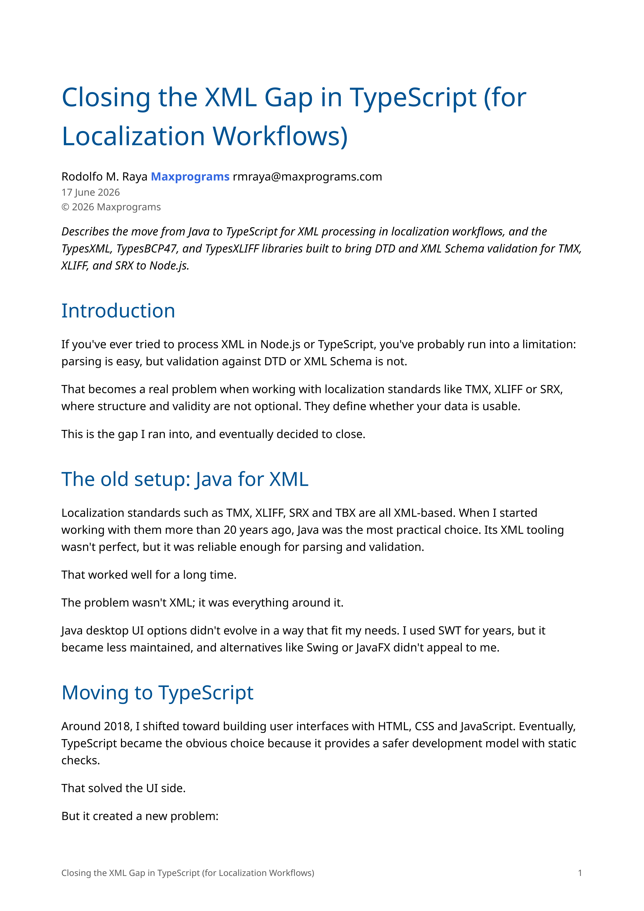
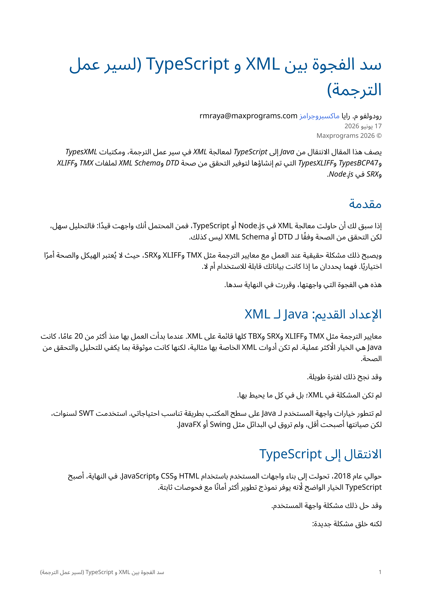
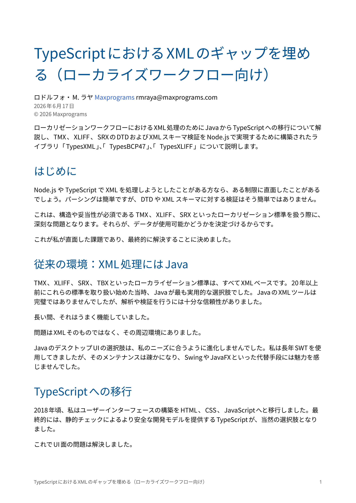

# CSSMedia

[](LICENSE)
[](https://www.typescriptlang.org/)

<table>
  <tr>
    <td></td>
    <td><h2>XML + CSS = PDF</h2></td>
  </tr>
</table>

CSSMedia is a TypeScript / Node.js engine that reads an XML file and a CSS stylesheet and generates a PDF that follows what the CSS specifications say must be done with that stylesheet.

Styling comes from CSS alone. The engine makes no assumptions about element names or attribute semantics, so any well-formed XML can be styled, not just a specific vocabulary like DITA or DocBook. PDF is the only output.

> **Work in progress.** CSSMedia already generates PDF files and is under active development. Support for CSS features is not complete yet, and more is being added.

- **[User Manual](manual/CSSMedia.pdf)**
- **[Quick Start](#quick-start)**
- **[Why CSSMedia](#why-cssmedia)**
- **[Features](#features)**
- **[Samples](#samples)**
- **[Usage](#usage)**
- **[Installation](#installation)**
- **[Related Projects](#related-projects)**
- **[Support](#support)**

One article in three languages, formatted by the same stylesheet:

<table>
  <tr>
    <th width="33%">English</th>
    <th width="33%">Arabic</th>
    <th width="33%">Japanese</th>
  </tr>
  <tr>
    <td></td>
    <td></td>
    <td></td>
  </tr>
</table>

## Quick Start

After [installing](#installation) CSSMedia, run it on the English sample from the `samples` folder:

```bash
cd samples
cssmedia -x xml_gap/xml_gap.xml -c xml_gap.css -p xml_gap/xml_gap.pdf
```

The command prints a warning about the DocBook DTD and generates `xml_gap/xml_gap.pdf`. See [xml_gap](#xml_gap) for the explanation and for the stylesheet techniques that the sample shows.

## Why CSSMedia

An XML document describes content, not pages. To publish it as a PDF you have to say how it looks on paper: page size and margins, fonts, headers and footers, page numbers, line breaking for each language.

The traditional way to do that is a two-step pipeline: an XSLT stylesheet transforms the XML into XSL-FO, and an FO processor renders the result. Both steps need specialized knowledge, and the stylesheets are usually written for one XML vocabulary, so each new vocabulary needs new stylesheets.

CSSMedia replaces that pipeline with a single CSS stylesheet applied directly to the XML. This is what changes:

- **The design is written in CSS.** A CSS rule says how an element looks. There are no templates, modes or XPath expressions to write, and no intermediate XSL-FO document to produce and debug. If you know XSL-FO, you can reuse that knowledge: many XSL-FO properties, such as `font-family`, `text-align` and `padding`, are also CSS properties.
- **The XML is styled directly.** The source document is not converted to another format first, so the structure of the output follows the structure of the document.
- **One engine for any XML vocabulary.** The engine does not assume anything about element names or attributes. Each vocabulary needs only its own stylesheet.
- **One stylesheet for many languages.** The same stylesheet can format a document in several languages and scripts, as the [xml_gap samples](#xml_gap) show.
- **Behavior defined by specifications.** Features are implemented from the CSS specifications, so what a property does is documented by the specification that defines it.

## Features

- **Multiple languages and scripts**: documents can be in any language, including right-to-left scripts such as Arabic and CJK languages such as Japanese. The [xml_gap samples](#xml_gap) show the same article in English, Arabic, Japanese and Russian, all styled by one stylesheet.
- **Hyphenation by language**: with `hyphens: auto`, words are hyphenated using the patterns of the language declared in the document by using `xml:lang`. CSSMedia includes 75 hyphenation pattern sets, which cover many languages and some of their variants, such as `en-us` and `en-gb`. The [swordfish_hyphens.pdf](samples/Swordfish/typesditac/swordfish_hyphens.pdf) sample is generated with hyphenation turned on.
- **CSS-only styling**: the XML is styled by CSS alone. Selector matching, specificity, cascade, inheritance and value resolution are CSSMedia's own code; `css-tree` is used only to parse CSS syntax.
- **Fonts**: OpenType, TrueType, collections, WOFF and WOFF 2.0 files, loaded from `@font-face` rules or a fonts folder, plus the 14 standard PDF fonts.
- **Images**: readers for PNG, JPEG, JPEG 2000 and WebP, written in CSSMedia's own code.
- **SVG and MathML**: SVG and MathML found in a document are handled as images.
- **Dependencies**: XML is parsed with [TypesXML](https://www.npmjs.com/package/typesxml), language tags are handled with [TypesBCP47](https://www.npmjs.com/package/typesbcp47), CSS syntax is parsed with `css-tree`, and `pdfnative` provides font data and the shaping of Indic and other complex scripts.

## Samples

The [samples](samples/) folder has XML files, stylesheets and the fonts they use. The stylesheets load the fonts from `samples/fonts` with `@font-face` rules.

### xml_gap

A DocBook article in four languages, all formatted with [xml_gap.css](samples/xml_gap.css). The Arabic, Japanese and Russian files were translated automatically with DeepL. The goal of the samples is to test typesetting, not to provide perfect localization.

| Language | XML | PDF |
| -------- | --- | --- |
| English | [xml_gap.xml](samples/xml_gap/xml_gap.xml) | [xml_gap.pdf](samples/xml_gap/xml_gap.pdf) |
| Arabic | [xml_gap_ar.xml](samples/xml_gap/xml_gap_ar.xml) | [xml_gap_ar.pdf](samples/xml_gap/xml_gap_ar.pdf) |
| Japanese | [xml_gap_ja.xml](samples/xml_gap/xml_gap_ja.xml) | [xml_gap_ja.pdf](samples/xml_gap/xml_gap_ja.pdf) |
| Russian | [xml_gap_ru.xml](samples/xml_gap/xml_gap_ru.xml) | [xml_gap_ru.pdf](samples/xml_gap/xml_gap_ru.pdf) |

The files declare a DocBook DTD. Without a catalog, CSSMedia prints the warning `External subset not found: docbook/docbookx.dtd` and still generates the PDF. To avoid the warning, pass a catalog that resolves the DTD with `-g`, such as the one in [TypesBook](https://github.com/maxprograms-com/TypesBook).

These are the techniques that the stylesheet uses:

| Result | CSS |
| ------ | --- |
| Local fonts | `@font-face` rules with `src: url("./fonts/NotoSans-Regular.ttf")` |
| Page size, margins and a footer with the document title and the page number | `@page` with `@bottom-left` and `@bottom-right`, `string-set: doc-title content()` on the title and `counter(page)` |
| A different font for each language | selectors such as `article[lang\|="ar"]` and `article[lang\|="ja"]` |
| Right-to-left text in Arabic | `direction: rtl` |
| Stricter line breaking in Japanese | `line-break: strict` |
| Links from an XML attribute | `-cssmedia-link: attr(url)` on `ulink` |
| An image from an XML attribute | `content: attr(fileref url)` on `imagedata` |
| The photo at the start side of the text, on the right in Arabic and on the left in the other languages | `float: inline-start` on `mediaobject` |
| An arrow after each link | `ulink::after { content: " \2197"; }` |
| Code listings in a monospace font | `font-family: "Noto Sans Mono", monospace` with `white-space: pre` |

### Swordfish

The User Guide of [Swordfish](https://maxprograms.com/products/swordfish.html), a real product, originally written in DITA, merged into one XML file in two ways. Each merged file needs a stylesheet written for its structure.

| Merged with | XML | Stylesheet | PDF |
| ----------- | --- | ---------- | --- |
| [TypesDitac](https://github.com/maxprograms-com/TypesDitac) | [swordfish.xml](samples/Swordfish/typesditac/swordfish.xml) | [ditac.css](samples/ditac.css) | [swordfish.pdf](samples/Swordfish/typesditac/swordfish.pdf) |
| [TypesDitac](https://github.com/maxprograms-com/TypesDitac) | [swordfish.xml](samples/Swordfish/typesditac/swordfish.xml) | [ditac_hyphens.css](samples/ditac_hyphens.css) | [swordfish_hyphens.pdf](samples/Swordfish/typesditac/swordfish_hyphens.pdf) |
| DITA Open Toolkit | [swordfish_dita-ot.xml](samples/Swordfish/dita-ot/swordfish_dita-ot.xml) | [dita-ot.css](samples/dita-ot.css) | [swordfish_dita-ot.pdf](samples/Swordfish/dita-ot/swordfish_dita-ot.pdf) |

Differences between the stylesheets:

| Stylesheet | Input | Hyphenation |
| ---------- | ----- | ----------- |
| `ditac.css` | TypesDitac file | none |
| `ditac_hyphens.css` | TypesDitac file | `hyphens: auto` on the root element, with the patterns of each language |
| `dita-ot.css` | DITA-OT file: the map comes first, then the topics | none |

### Merging a DITA map

CSSMedia reads one XML file, so a DITA map and its topics have to be merged first. The commands below use the map of the CSSMedia manual, [manual/CSSMedia.ditamap](manual/CSSMedia.ditamap), as the example.

**With TypesDitac**, use the `--merge` option and name the output file with `-o`:

```bash
typesditac CSSMedia.ditamap --merge -o CSSMedia_MERGED.xml
```

**With the DITA Open Toolkit**, the PDF transformation writes the merged file to its temporary directory, and DITA-OT deletes that directory after the build. To keep the merged file, set `clean.temp` to `no`:

```bash
dita --input=CSSMedia.ditamap --format=pdf --output=out --temp=temp --clean.temp=no
```

The merged file is `temp/CSSMedia_MERGED.xml`: the name of the map without its extension, followed by `_MERGED.xml`. The `--temp` option is optional and makes the location predictable.

## Usage

Run `cssmedia` and the program prints this help text:

```text
Usage: cssmedia -x <file> -c <file> -p <file> [-f <fontsFolder>] [-g <catalog>]

  -x, --xml <file>       XML file to format
  -c, --css <file>       CSS stylesheet to apply
  -p, --pdf <file>       PDF file to write
  -f, --fonts <folder>   (optional) alternative fonts folder
  -g, --catalog <file>   (optional) OASIS catalog to use when parsing XML
```

Example:

```bash
cssmedia -x document.xml -c document.css -p document.pdf
```

Use `-g` to pass a custom OASIS catalog, so that the XML file is read with its associated grammars:

```bash
cssmedia -x document.xml -c document.css -p document.pdf -g catalog.xml
```

Warnings are printed to stderr. When processing fails, the program prints the error and exits with code 1; wrong arguments exit with code 2.

### Fonts

Fonts come from the `@font-face` rules of the stylesheet, then from the folder given with `-f`. CSSMedia does not search the fonts installed on the computer. The 14 standard PDF fonts are always available under the family names `Times`, `Helvetica`, `Courier`, `Symbol` and `ZapfDingbats`. A declared family or a family in the `-f` folder with the same name takes precedence.

CSSMedia loads OpenType and TrueType (`.otf`, `.ttf`), OpenType collections (`.otc`, `.ttc`), WOFF 1.0 (`.woff`) and WOFF 2.0 (`.woff2`) fonts. The User Manual describes the `@font-face` descriptors, the `format()` and `tech()` values that are supported, and the sources that are skipped.

### Using CSSMedia as a Library

`PdfGenerator.generate()` writes the PDF. The constructor takes the optional font folder and the optional XML catalog, and the warnings of the last run are in `warnings`:

```typescript
const generator: PdfGenerator = new PdfGenerator("/path/to/fonts");
generator.generate("document.xml", "document.css", "document.pdf");
generator.warnings.forEach((warning: string): void => console.error(warning));
```

## Installation

### From the tarball

The package is the tarball `cssmedia-x.x.x.tgz` in the root of this repository.

```bash
npm install -g file:cssmedia-x.x.x.tgz
```

The `-g` option installs the package globally and adds the `cssmedia` command, which you can run from any folder. To install it locally in a project instead:

```bash
npm install file:cssmedia-x.x.x.tgz
```

### From source

You need Node.js 24 or newer and npm.

```bash
git clone https://github.com/maxprograms-com/CSSMedia.git
cd CSSMedia
npm install
npm run build
```

`npm run build` compiles `ts/` to `dist/`. The command is then available as:

```bash
node ./dist/cssmedia.js [options]
```

## User Manual

The [CSSMedia User Guide](manual/CSSMedia.pdf) (PDF) explains how to run CSSMedia and how to write stylesheets for it. It is still a work in progress.

The manual is written in DITA XML and its PDF is generated with CSSMedia itself, so it is also an example of what CSSMedia produces. See [manual/README.md](manual/README.md) for the build instructions.

## Related Projects

- **[TypesXML](https://github.com/maxprograms-com/TypesXML)** parses the XML documents that CSSMedia formats.
- **[TypesBCP47](https://github.com/maxprograms-com/TypesBCP47)** validates and normalizes the language tags found in documents.
- **[TypesDitac](https://github.com/maxprograms-com/TypesDitac)** merges a DITA map and its topics into the single XML file. The User Guide is built by processing the files in `manual` with TypesDitac and CSSMedia.
- **[TypesBook](https://github.com/maxprograms-com/TypesBook)** merges a set of DocBook XML documents into a single XML.

## Support

Report problems and request features using GitHub Issues. For support, write to [tech@maxprograms.com](mailto:tech@maxprograms.com) or visit the [Maxprograms support page](https://maxprograms.com/support/index.html).

## Project Layout

- `ts/`: source files, in folders by component (`css`, `fonts`, `images`, `layout`, `mathml`, `pages`, `paint`, `parse`, `pdf`, `svg`, `writer`)
- `dist/`: compiled JavaScript and declarations (`npm run build`)
- `manual/`: source of the User Guide, written in DITA XML
- `licenses/`: licenses of the included components

---

## Legal

CSSMedia is Copyright © 2026 Maxprograms. See the [LICENSE](LICENSE) file for the terms of use. License information for all included components is available in the [licenses](licenses/README.md) directory.
